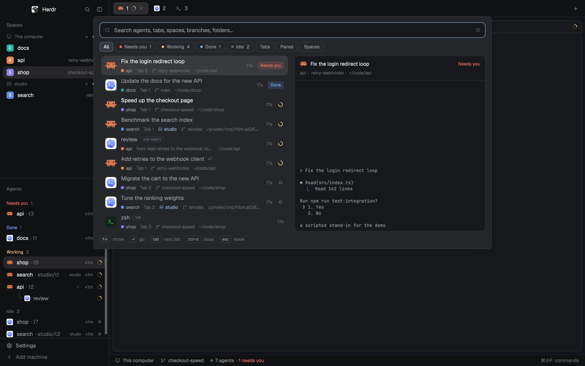

# Bar

A quick switcher that drops from the top of the window when its key is pressed. It lists every
agent, tab, pane and space on this computer and on every connected machine, with live status.
The person types to search, switches lists with Tab, sees the selected terminal's screen on
the right, and presses Enter to go there.

## What you see

One mod, `bar`, opened as a popup: 980 px wide, at the top of the window, 40 px down. Herdr
draws the frame. Inside, 14 px padding, 10 px between regions, on `popover`, top to bottom:

- **Search field**, 38 px, 10 px radius, 1 px `accent` border on `background`: a 15 px search
  icon in `dim`, the input (13.5 px, placeholder "Search agents, tabs, spaces, branches,
  folders…"), and at the right the row count in `dim`, 11 px: `6` when everything in the list
  shows, `2 of 6` when the search narrows it.
- **Chips**, 24 px, 7 px radius, 11.5 px text, 5 px apart: All, Needs you, Working, Done, Idle,
  Tabs, Panes, Spaces. The four status chips lead with a 6 px dot in that status's theme color
  (`dim` at 40% when the count is 0) and end with the count of agents in that status. The
  chosen chip has `foreground` text, semibold, an `accent` border at 40% and an `accent` fill
  at 13%; the others have `muted` text and a `border` border.
- **Body**, 432 px tall (nine rows), two columns 12 px apart:
  - **List**, left half. Rows are 48 px, 9 px radius, 4 px from the edges. A row, left to right:
    - a 28 px icon: the program's icon from the app's table, on its `tile` color when it has
      one, else on `raised`; a picture icon (`tint` false) drawn as is; a terminal glyph when
      the program has no icon; for a space, its color with its first letter in white;
    - two lines. Line one, 13.5 px: the title (`foreground` and semibold when it is where the
      person is, else `muted`; `foreground` when selected), with matched letters in `accent`
      semibold; a pin glyph when pinned; a small outlined word for rows that are not agents
      (`tab`, `pane`, `space`) and for sub-agents (`sub-agent`); `+N` when the agent has N
      sub-agents. Line two, 11 px in `dim`: a 7 px square in the space's color and the space's
      name in `muted`; the tab (`Tab 2`, or its name), or for an agent in a named tab what it
      says it is doing; the machine with a server glyph in `accent`, for other machines; the
      branch with a branch glyph; the folder, from `~` on this computer;
    - the running time in `dim`, 11 px: for a working agent, how long since its status
      changed; otherwise how long the terminal has been up. Format `47s`, `12m`, `2h04m`, `4d3h`;
    - the status mark.
  - **Preview**, right half, 10 px radius, 1 px `border`, on `background`. A header on `surface`
    with an 18 px icon, the title in semibold, the machine in `accent`, the status word in its
    color, and under it `space · branch · folder` in `dim`. Below, the terminal's screen in the
    terminal font at 11 px, 15 px lines, in `muted`, bottom-aligned so the newest lines show.
    For a space, the list of its tabs instead. Narrower than 760 px, the preview is left out
    and the list takes the width.
- **Hints**, 11 px: `↑↓ move`, `↵ go`, `tab next list`, `ctrl-d close`, `esc leave`, each key
  in a small outlined box.

## How it behaves

- **Statuses.** Working: a 13 px ring in `working`, turning once every 900 ms. Blocked: a pill
  "Needs you", `blocked` text on `blocked` at 15%. Done: the same pill, "Done", in `done`. Idle:
  an 8 px ring, 1.5 px, in `idle`. A program that reports no status has no mark. A status of
  `error` counts as blocked. A sub-agent that is done shows as idle: it reports to its parent.
- **Rows.** An agent row for every entry of `agents()`, and for every live terminal that one of
  them started, directly or through others, and that has no pane. A tab row for every tab, a
  pane row for every terminal pane, a space row for every space.
- **Titles.** An agent alone in a tab somebody named goes by the tab's name. Otherwise it goes
  by its terminal title with the leading status glyph removed, unless that title only repeats
  the program, a path, a `user@host` or the terminal's address; then by its program's name.
- **Lists.** All: agents, and tabs with no agent in them; once the person types, spaces too.
  Needs you, Working, Done, Idle: agents in that status. Tabs: every tab. Panes: every
  terminal pane. Spaces: every space. The list last used is kept and opens again next time.
- **Order.** Without a search: blocked, then done, then pinned, then most recently visited,
  then working before idle, then newest. With a search: best match first, the same order
  breaking ties. "Visited" is where the person was each time the bar opened and each row they
  went to through it.
- **Selection.** Starts on the first row that is not where the person is (the top row once
  they type). It stays on the same row while the list changes under it.
- **Search.** Words separated by spaces; each must match, as letters in order, in the title,
  the second-line detail, the space, the branch, the program, the machine, the folder, the
  status word or the terminal address. Lowercase ignores case; a capital asks for it.
- **Keys.** Up, Down, Ctrl+P, Ctrl+N, Ctrl+K, Ctrl+J move, wrapping. Page Up and Page Down
  move by nine. Enter goes. Tab and Shift+Tab switch lists. Ctrl+D arms a close: the row shows
  "ctrl-d again to close tab" in the blocked pill, and a second Ctrl+D does it; moving the
  selection disarms it. Esc leaves.
- **Enter and click.** Space: `space.select`. Tab: `tab.select`. Agent or pane: `pane.focus`
  with its pane. Sub-agent: `terminal.peek`. The bar closes first.
- **Close.** Space: `space.close`. Pane: `pane.close`. Sub-agent: `terminal.kill`. Agent or
  tab: `tab.close`. Space and tab closes pass `confirmed: true`. The bar stays open.
- **Preview.** Read 90 ms after the selection rests on a row, and again every 1500 ms. The
  wheel scrolls the list and the selection follows it.

## Built from

- `mods/bar/mod.json`: `{ "place": "none", "title": "Bar", "overlay": { "kind": "popup", "at":
  "top", "offset": 40, "width": 980, "height": 0.9 } }`. Opened with `mod.open {name: "bar"}`.
- `mods/bar/main.js`: the view. From `herdr`: `agents`, `panes`, `spaces`, `terminals`, `run`,
  `hc`, `home`, `theme`, `settings`, `props`, `closeOverlay`, `shared`, `setShared`. From
  `gpui-base`: `InputState`, `Input`, `v_flex`, `h_flex`.
- `mods/bar/rows.js`: `build` (the rows), `inView`, `search`, `order`, `firstPick`, `visit`,
  `counts`, `duration`, `shortPath`. No app imports.
- `mods/bar/fuzzy.js`: `match(term, text)` returns `{ score, positions }` or null, by dynamic
  programming over the two strings; `segments` splits a title into matched and unmatched runs.
- Programs: `hc read <address>` for the preview, through `hc()`.
- Shared state: `bar.recent` (row keys, latest first, at most 60), `bar.view`. Reads
  `space.colors`.
- Art: `spinner.svg`, `search.svg`, `branch.svg`, `machine.svg`, `pin.svg`, `terminal.svg`,
  Lucide outlines drawn with `svg()` so they take the text color.
- `keys.json`: `"cmd-k": "mod.open:bar"` under `global`.

## Watch out

- `flex_shrink` takes a number. `flex_shrink()` fails the render with "expected a number, got
  nil", and `herdr-app check` does not catch it because rows are not drawn with empty data.
- Text has no styled runs. The highlighted title is a row of `div`s, one per run; spaces at
  the edge of a run are written as non-breaking spaces so they are not dropped.
- The list draws only the rows in view, each `absolute` at `index * 48 - scroll`, inside a
  `relative` box with `overflow_hidden`. Sizes from `on_size_change` are divided by
  `settings().zoom`.
- The popup takes the keyboard a moment after it opens: focus the input in `init` and again
  300 ms later. Keys are handled on the root's `on_key_down`; they reach it from the input.
- A preview read can finish after the selection has moved on. Each read carries a counter and
  only the latest is kept. The view re-renders only when the text changed.
- Remote ids carry a `machine/` prefix; `hc read studio/t7` reads that machine's terminal.
- A remote shell's pane title is its own address. Treat it as saying nothing.
- A mod cannot draw a live terminal inside its own view, so the preview is text without color.
- With more than a few hundred rows the search runs on every keystroke over all of them; it
  was built for tens.

## Done when

- `npm test` passes and `herdr-app check mods/bar` prints `check passed`.
- `herdr-app do mod.open --name bar` drops the bar from the top; running it again closes it.
- With an agent working in another tab, its row shows a turning ring and a running time.
- Typing part of a title leaves the matching rows, with the matched letters in the accent color.
- Tab moves the chosen chip one to the right, and the list changes to that kind.
- Selecting an agent on another machine shows that machine's name and its screen in the preview.
- Enter on a row closes the bar and shows that agent, tab or space.
- Ctrl+D shows "ctrl-d again to close tab"; pressing Down removes it without closing anything.
